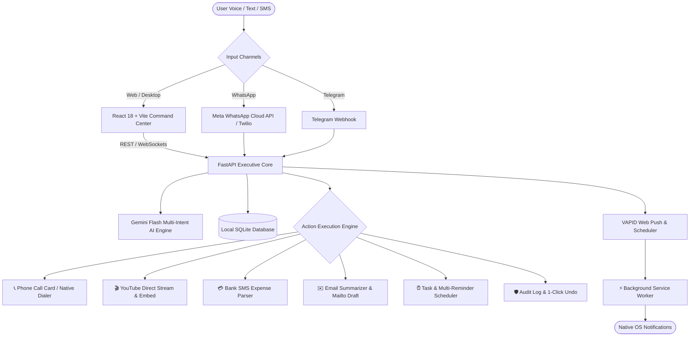

# Aether ⚡
> **Autonomous Personal AI Executive & Wealth Assistant**  
> *Understands. Remembers. Takes Initiative. Executes Real Work.*

[](https://fastapi.tiangolo.com/)
[](https://reactjs.org/)
[](https://ai.google.dev/)
[](https://developers.facebook.com/docs/whatsapp)
[](https://www.w3.org/TR/push-api/)
[](https://opensource.org/licenses/MIT)

---

## 🌟 Vision & Overview

**Aether** is an autonomous personal AI executive core built to transition beyond traditional chat dialogs. It operates continuously in the background, acts on natural voice and text commands across multiple platforms (Web, Desktop, WhatsApp, and Telegram), preserves an auditable long-term memory vault, and automates everyday executive workflows—from scheduling and financial tracking to media playback and one-tap communication.

Aether is bilingual by design, providing native comprehension and voice synthesis across **English**, **Hindi (हिन्दी)**, and **Hinglish**.

---

## 🚀 Key Features in Detail

### 1. 📞 Smart Phone Calling & Native Dialer
- **Natural Intent Recognition**: Say *"Call Rahul"*, *"Pawan ko call lagao"*, or mention any phone number.
- **Entity Resolution**: Automatically extracts contact names and telephone numbers.
- **Instant Trigger**: Renders an interactive Call Card with direct phone-dialer integration (`tel:...`) for seamless dialing on Android, iOS, or macOS.

### 2. 🎬 In-App & Remote YouTube Media Playback
- **Direct Stream Resolution**: Request songs, bhajans, podcasts, or videos (e.g. *"Play Hanuman Chalisa on YouTube"*).
- **In-Chat Embedded Player**: Resolves top video matches in real time and embeds an interactive, high-definition player directly inside the conversation thread.
- **WhatsApp Rich Media**: Outgoing WhatsApp responses include direct playable watch URLs and video thumbnails with zero manual searching.

### 3. 💳 Automated Bank SMS Expense Parsing
- **Intelligent Transaction Detection**: Forward or paste raw transactional SMS messages from Indian banks (SBI, HDFC, ICICI, Axis, Kotak, Paytm, PhonePe, Google Pay, UPI).
- **Deep Entity Extraction**: Extracts exact debit/credit amounts, merchant/vendor names, account identifiers, and transaction categories.
- **Historical Timestamp Preservation**: Automatically parses and respects the exact date and time mentioned in the SMS rather than using the current time, maintaining flawless financial ledgers.

### 4. ✉️ AI Email Reader & Draft Composer
- **Inbound Email Analysis**: Paste lengthy emails or threads; Aether extracts key action items, deadlines, and core context.
- **One-Click Draft Review**: Generates polite, professional draft replies based on user intent.
- **Client Hand-off**: Provides one-click **"Open in Gmail / Mail"** (`mailto:...`) and clipboard copy buttons for instant review and dispatch.

### 5. 🎙️ Multi-Task Voice Dictation
- **Multi-Intent Extraction**: Dictate several tasks in a single breath (e.g. *"Tomorrow morning 9 AM team sync and 5 PM evening gym"*).
- **Automated Breakdown**: Breaks composite sentences into distinct agenda items with individual due dates, reminder times, and priority tiers.
- **Full Rollback Support**: Created tasks are logged under a unified audit entry, enabling 1-click bulk undo if needed.

### 6. 📱 Omnichannel Executive Assistant (WhatsApp & Telegram)
- **WhatsApp Cloud API & Twilio**: Chat with Aether directly on WhatsApp to add tasks, log expenses, or ask queries on the go.
- **Scheduled Proactive Digests**:
  - **☀️ Morning Briefing (8:00 AM IST)**: Overview of the day's weather, priority tasks, and upcoming meetings.
  - **🌙 Evening Wrap-up (8:30 PM IST)**: Review of completed tasks, pending items, and daily financial summary.
- **Telegram Bot Support**: Real-time webhooks for seamless messaging on Telegram.

### 7. 🔔 24/7 OS-Level VAPID Web Push Notifications
- **Browser-Independent Delivery**: Reminders trigger native OS banners and ring audio even when the browser or application is completely closed.
- **Zero-Drop Guarantee**: Reminders remain active until confirmed delivery; expired tokens (404/410) are automatically pruned, and Service Worker automatically re-syncs new subscriptions with the backend.

### 8. 🧠 Controlled Memory Vault & 1-Click Undo
- **Auditable Long-Term Memory**: Stores user preferences, routines, and habits in categorized memory buckets (`routine`, `preference`, `fact`, `schedule`).
- **100% Reversible**: Every automated action (task creation, expense logging, note entry) is logged in an `AuditLog` table with confidence scores and can be undone with a single tap.
- **Privacy-First Architecture**: Your data is stored locally in an auditable SQLite database. No passwords, credentials, or personal bank logins are ever requested or stored.

### 9. 📊 Interactive Executive Command Center
- **Live Weather Integration**: Real-time temperature, condition summaries, humidity, and wind stats for your city.
- **Today's Tasks Checklist**: Clean interactive dashboard card with circular checkboxes, priority tags, and recurrence indicators (`[DAILY 🔁]`, `[MON-FRI 🔁]`).
- **Interactive 3D Particle Orb**: WebGL audio-reactive particle sphere responding dynamically to speech synthesis and microphone input.

---

## 🏛️ System Architecture



---

## 📁 Repository Structure

```text
aether/
├── server/                    # FastAPI Backend Core
│   ├── main.py                # REST Endpoints, Cron Schedulers, Webhooks
│   ├── ai_engine.py           # Gemini LLM Parser, SMS & YouTube Resolvers
│   ├── models.py              # SQLAlchemy Data Models (Tasks, Finance, Memory)
│   ├── database.py            # SQLite Connection & Migration Engine
│   └── requirements.txt       # Python Dependencies
├── desktop/                   # React 18 + Vite Executive Command Center
│   ├── src/
│   │   ├── App.jsx            # Main Application Shell & Omnibar
│   │   ├── components/
│   │   │   ├── dashboard/     # Live Weather, Today's Tasks, Quick Actions
│   │   │   ├── voice/         # 3D Particle Orb & Audio Visualizers
│   │   │   ├── finance/       # Wealth Ledger, Expense Analytics
│   │   │   └── memory/        # Auditable Memory Vault & Log Inspector
│   │   └── services/          # API Services & WebSocket Connectors
│   ├── public/
│   │   └── sw.js              # Service Worker for Background VAPID Push
│   └── package.json           # Frontend Dependencies
├── mobile/                    # Mobile App Codebase
└── docs/                      # Architectural Blueprints & Gap Analysis
```

---

## 🛠️ Quick Start & Local Setup

### Prerequisites
- **Python 3.10+**
- **Node.js 18+** & `npm`
- **Google Gemini API Key** (Free tier available at [Google AI Studio](https://aistudio.google.com/))

### 1. Backend Setup
```bash
# Navigate to server directory
cd server

# Create and activate virtual environment
python3 -m venv venv
source venv/bin/activate  # On Windows: venv\Scripts\activate

# Install dependencies
pip install -r requirements.txt

# Configure environment variables
cp .env.example .env
# Edit .env and supply GEMINI_API_KEY, VAPID keys, and optional WhatsApp credentials

# Run FastAPI Server
uvicorn main:app --host 127.0.0.1 --port 8000 --reload
```

### 2. Frontend Setup
```bash
# Navigate to desktop directory
cd desktop

# Install npm dependencies
npm install

# Start Vite dev server
npm run dev
```
Open **`http://localhost:5173`** in your browser.

---

## 🔒 Privacy & Safety Guarantee

1. **Local Data Ownership**: All tasks, financial summaries, SMS records, and memory vault items reside on your local SQLite database.
2. **Zero Credential Requests**: Aether never requests your bank account numbers, passwords, OTPs, or net-banking credentials.
3. **Explicit Consent on Execution**: High-impact actions are staged with visual cards (Call, Draft Email, YouTube playback) before final dispatch.
4. **Full Auditability**: Every automated background deduction or memory update is logged with a visible confidence score and can be reversed with a single tap.

---

## 📄 License

This project is licensed under the **MIT License** — see the [LICENSE](LICENSE) file for details.
