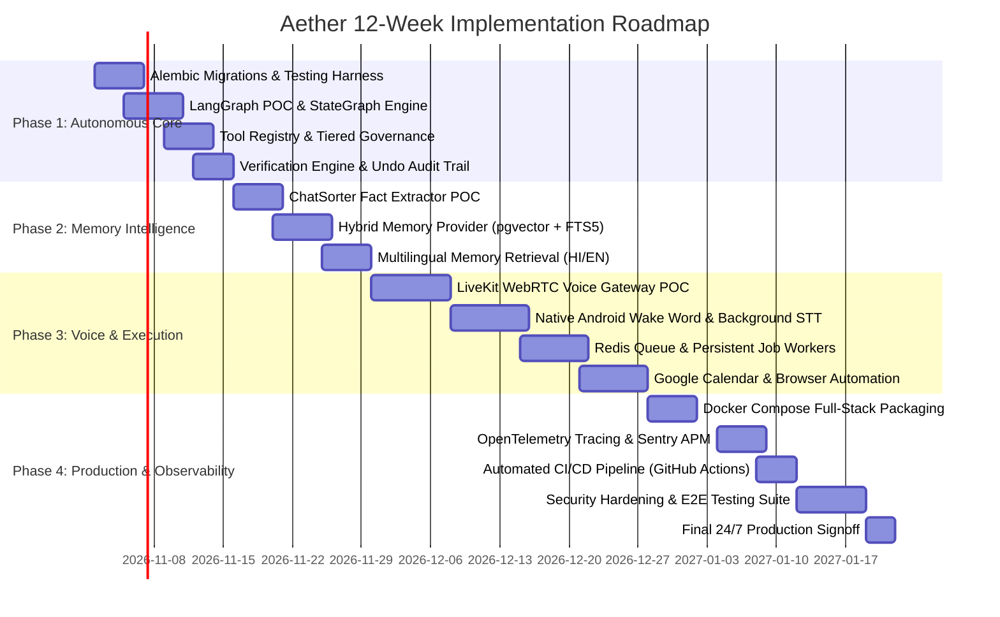
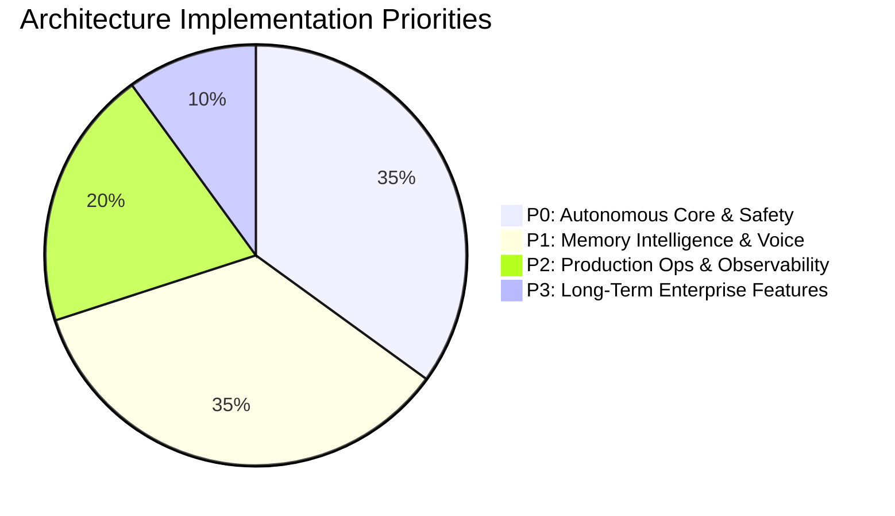

# Aether 12-Week Implementation Roadmap & Execution Plan

**Document Version:** 1.0.0  
**Target Window:** Q4 2026 – Q1 2027 (12 Consecutive Weeks)  
**Methodology:** Incremental Agile Sprints with Continuous Working Deployments  
**Constraint:** Zero regression on existing working desktop/mobile features; no code rewrites.

---

## 1. Executive Phasing Timeline

---

## 2. Phase-by-Phase Sprint Breakdown

### Phase 1 — Autonomous Core (Weeks 1–2) — Priority P0
**Primary Objective:** Transition Aether from a single-turn prompt responder to a stateful, multi-step autonomous agent with built-in safety rails and database migration versioning.

#### Week 1: Foundation, Migrations & LangGraph POC
* [ ] **Alembic Database Migration Baseline:**
  * Initialize Alembic inside `server/`.
  * Generate baseline revision 001 reflecting current SQLite/Supabase models (`users`, `tasks`, `notes`, `finances`, `memory_vault`, `audit_logs`).
  * Deprecate runtime `ensure_schema_migrations()` in `database.py`.
* [ ] **Automated Test Harness (Pytest):**
  * Setup `pytest` and `pytest-asyncio` test suite for API routers, auth validation, and database CRUD.
* [ ] **LangGraph Orchestrator POC:**
  * Implement `server/agent/graph.py` with `StateGraph`.
  * Define core agent state: `messages`, `context`, `plan`, `current_step`, `tool_results`, `error_state`.
  * Establish checkpoint persistence via SQLAlchemy/PostgreSQL checkpointer.

#### Week 2: Tool Registry, Governance & Verification
* [ ] **Modular Tool Registry (`server/agent/tools/`):**
  * Refactor existing actions into typed LangGraph tools using Pydantic schemas:
    * `TaskTool` (Create, Update, List, Complete)
    * `FinanceTool` (Record Expense/Income, Query Ledger, Compute Net Balance)
    * `NoteTool` (Create, Search, Summarize)
    * `WeatherTool` (Fetch Live Weather for current coordinates)
    * `WebSearchTool` (Live web research fallback)
* [ ] **Permission Engine Integration:**
  * Implement Tier classification logic (`Tier 1: Read`, `Tier 2: Safe Mutate`, `Tier 3: Critical Confirm`).
  * Implement LangGraph `interrupt_before` node for Tier 3 actions.
* [ ] **Verification Engine & Undo Ledger:**
  * Implement pre-execution input validator and post-execution result verifier.
  * Guarantee every mutating tool produces a reversible JSON payload in `audit_logs`.
* **Deliverable Milestone 1:** Aether can execute multi-step user prompts (e.g., *"Look at my budget, add a 500 grocery expense, and set a reminder to verify my receipt tonight"*) reliably in a single workflow.

---

### Phase 2 — Memory Intelligence (Weeks 3–4) — Priority P1
**Primary Objective:** Enable Aether to automatically extract facts, remember preferences, and recall historical conversations across both Hindi and English.

#### Week 3: ChatSorter & Fact Extraction
* [ ] **ChatSorter Worker Service (`server/memory/chatsorter.py`):**
  * Asynchronous background job that scans new message exchanges.
  * Uses Gemini 2.5 Flash with structured output to extract discrete facts:
    * User preferences, recurring commitments, personal relationships, financial rules.
* [ ] **Episodic Memory Schema:**
  * Define structured memory table: `id`, `user_email`, `fact_type`, `content`, `confidence`, `last_accessed_at`, `embedding`.

#### Week 4: Hybrid Vector Retrieval & Multilingual Benchmarking
* [ ] **PostgreSQL `pgvector` Integration:**
  * Activate `pgvector` extension in Supabase PostgreSQL via Alembic migration.
  * Embed facts and notes using Google `text-embedding-004` (768 dimensions).
* [ ] **Local SQLite FTS5 Mirror:**
  * Maintain local SQLite full-text search index for exact keyword matching (names, numbers, specific locations).
* [ ] **Reciprocal Rank Fusion (RRF) Hybrid Retriever:**
  * Combine semantic cosine similarity with BM25 keyword rankings.
* [ ] **Multilingual Recall Verification:**
  * Test retrieval accuracy across pure Hindi, pure English, and colloquial Hinglish (e.g., *"Maine kal gym ke baare me kya bola tha?"* ↔ *"What did I say yesterday about the gym?"*).
* **Deliverable Milestone 2:** Aether recalls past user decisions, references previous interactions seamlessly, and personalizes responses without blowing up prompt token counts.

---

### Phase 3 — Voice & Execution (Weeks 5–8) — Priority P1
**Primary Objective:** Deliver natural, low-latency voice conversations and persistent background workflow execution.

#### Weeks 5–6: LiveKit Real-Time WebRTC Voice Pipeline
* [ ] **LiveKit Server & Token Gateway:**
  * Deploy self-hosted or cloud LiveKit WebRTC instance.
  * Expose `/api/voice/token` endpoint in FastAPI for client room authentication.
* [ ] **WebRTC Client Integration:**
  * Integrate LiveKit Web SDK in React 19 desktop/mobile UI.
  * Replace browser `webkitSpeechRecognition` with bi-directional streaming audio.
* [ ] **Edge Voice Activity Detection (VAD):**
  * Integrate Silero VAD to detect user speech start/stop in under 50ms.
* [ ] **Native Android Wake Word & Background Audio:**
  * Integrate lightweight local wake-word detector ("Hey Aether") in the Android shell.
  * Ensure audio sessions remain active when the app is minimized or the screen is locked.

#### Weeks 7–8: Redis Job Queue & External Digital Workflows
* [ ] **Redis Queue & Worker Infrastructure:**
  * Provision Redis 7 broker.
  * Implement ARQ background worker process (`server/workers/main.py`).
  * Migrate the 5-minute reminder loop from in-memory `asyncio.sleep` to persistent Redis cron jobs.
* [ ] **Google Calendar Two-Way Sync:**
  * Upgrade Google Calendar integration from one-way push to bidirectional delta synchronization with webhooks.
* [ ] **Browser Automation Worker (Playwright):**
  * Headless browser automation worker for retrieving receipts, web summaries, or checking flight statuses on operator request.
* **Deliverable Milestone 3:** Bi-directional sub-200ms voice dialogue with Aether; guaranteed 100% reminder delivery through server restarts.

---

### Phase 4 — Production Readiness & Observability (Weeks 9–12) — Priority P2
**Primary Objective:** Transform Aether into a hardened, 24/7 available personal executive appliance.

#### Weeks 9–10: Containerization, Tracing & Error Triage
* [ ] **Full-Stack Docker Compose Architecture:**
  * Production-ready `docker-compose.yml` defining:
    * `backend`: FastAPI + Uvicorn
    * `worker`: ARQ / Redis Job Worker
    * `redis`: Persistent Redis 7
    * `frontend`: Nginx serving optimized React 19 production build
* [ ] **Sentry Error Tracking:**
  * Sentry React SDK in frontend for UI crash reporting.
  * Sentry Python SDK in FastAPI and background workers for unhandled exceptions.
* [ ] **OpenTelemetry (OTel) Distributed Tracing:**
  * Instrument FastAPI endpoints, SQLAlchemy queries, and LLM call spans.
  * Measure end-to-end latency for voice and multi-step tool execution.

#### Weeks 11–12: Security Hardening, Automated CI/CD & Final Signoff
* [ ] **Supabase Row-Level Security (RLS) Enforcement:**
  * Strict RLS policies across all tables locking read/write access to `auth.uid() = user_id`.
* [ ] **Automated CI/CD Pipeline (GitHub Actions):**
  * Pull request linting, type-checking (Pyright/TypeScript), automated Pytest suite, and Docker build test.
* [ ] **Automated Backup & Disaster Recovery:**
  * Nightly automated Supabase database backups and encrypted SQLite vault snapshotting to Google Drive / S3.
* [ ] **End-to-End Test Suite:**
  * Playwright E2E tests simulating voice capture, multi-step financial recording, and dashboard rendering.
* **Deliverable Milestone 4:** High-availability, self-healing, auditable production deployment ready for continuous 24/7 personal operation.

---

## 3. Prioritized Implementation Checklist (P0 / P1 / P2 / P3)

### 🔴 P0 — Critical Core (Weeks 1–2)
1. **Alembic Database Migrations** (Clean version control for SQLite and PostgreSQL).
2. **LangGraph Agent StateGraph** (Multi-step tool calling and reasoning loop).
3. **Modular Tool Registry** (Tasks, Notes, Finance, Weather, Search).
4. **Permission Engine** (Strict 3-tier action authorization).
5. **Verification Engine & Undo Audit Trail** (Non-destructive operations with instant undo).

### 🟡 P1 — High Value Capabilities (Weeks 3–8)
1. **ChatSorter Fact Extractor** (Automatic extraction of preferences and commitments).
2. **PostgreSQL `pgvector` Hybrid Memory** (Semantic vector search + SQLite FTS5).
3. **LiveKit WebRTC Voice Gateway** (Sub-200ms real-time conversational voice).
4. **Native Android Wake Word Engine** (Reliable "Hey Aether" activation).
5. **Redis Persistent Worker Queue** (Durable background job scheduling).

### 🟢 P2 — Operational Excellence (Weeks 9–12)
1. **Full-Stack Docker Compose** (Reproducible production packaging).
2. **Sentry Error Triage** (Real-time alert monitoring for frontend & backend).
3. **OpenTelemetry APM** (End-to-end tracing and latency benchmarking).
4. **GitHub Actions CI/CD** (Automated testing, linting, and build validation).
5. **Playwright E2E Testing Suite** (Regression testing for Web & Mobile WebView).

### ⚪ P3 — Explicitly Deferred / Not Recommended Today
* ❌ **Kubernetes (K8s):** Unnecessary operational complexity; Docker Compose on a single VPS or homelab server is 10x simpler and cheaper.
* ❌ **Temporal:** Operational overhead of running a separate Temporal cluster is unjustified when LangGraph checkpointers + Redis queue cover all workflow needs.
* ❌ **Dedicated Qdrant Cluster:** Supabase `pgvector` eliminates an entire separate database cluster and saves hosting costs.
* ❌ **Microservices Decomposition:** Preserving the modular monolith keeps debugging simple, eliminates network serialization latency, and avoids distributed transaction bugs.
* ❌ **Frontend Framework Rewrite:** React 19 + Vite 8 provides modern speed, high reactivity, and seamless PWA/WebView compatibility.

