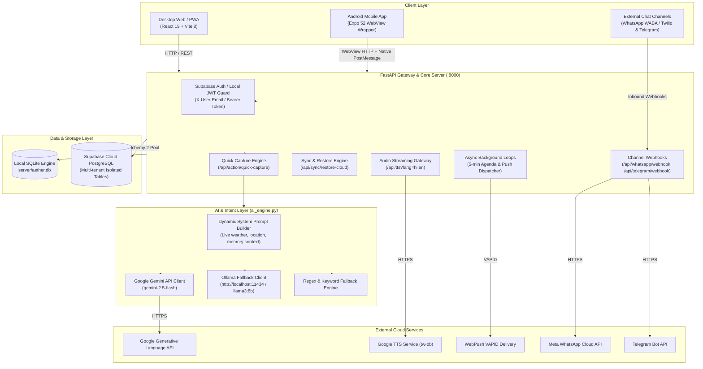
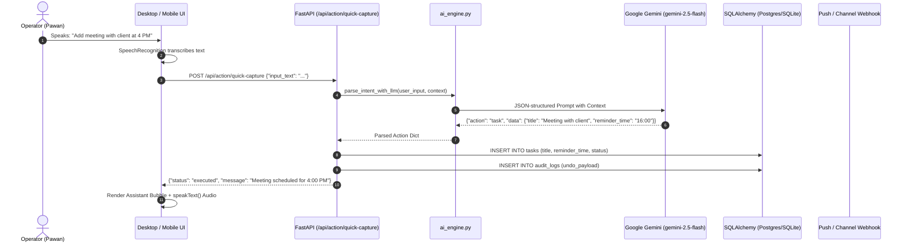

# Aether System Architecture — Current Baseline Audit (As-Is)

**Document Version:** 1.0.0  
**Audit Date:** October 30, 2026  
**Auditor:** Antigravity AI Engineering & Architecture Review  
**Target Repository:** `/Users/pawandixit/Desktop/Projects/aether`

---

## 1. Executive Summary

Aether is currently constructed as a **Hybrid-Cloud Executive AI Assistant & Digital Chief of Staff**, designed to assist the operator (Pawan Dixit) with task scheduling, financial expense/income ledgering, contextual fact recall, web news/weather intelligence, and multi-channel messaging (WhatsApp, Telegram, Push Notifications).

The system currently operates as a **Monolithic Service Architecture** with three core components:
1. **Frontend Client (Desktop/PWA):** React 19 + Vite 8.
2. **Mobile Client Shell:** Expo 52 + React Native 0.76 hosting a native WebView bridge.
3. **Core Backend Engine:** Python 3.12 + FastAPI + SQLAlchemy 2 with dual SQLite / Supabase PostgreSQL persistence and Gemini/Ollama LLM intent extraction.

---

## 2. Current Architecture Diagram (C4 Level 2 Container)

---

## 3. Component Inventory & Codebase Analysis

### 3.1 Frontend (`desktop/`)
* **Framework:** React 19.3.1 running on Vite 8.3.4 (ESM modules).
* **State Management:** Local React state (`useState`, `useEffect`, `useRef`) consolidated primarily inside `desktop/src/App.jsx` (~5,700 LOC).
* **UI Structure:**
  * Minimalist Executive Dark Landing (`gemini-screen-container`).
  * Center Stage: Holographic Particle Sphere canvas + interactive prompt dock.
  * Executive Dashboard: `DashboardView.jsx` (Overview cards, weather widget, agenda preview, quick actions).
  * Sub-Modals: `FinanceModal.jsx`, `TasksModal.jsx`, `HistoryModal.jsx`, `DriveModal.jsx`, `PermissionsModal.jsx`, `SettingsSubModals.jsx`.
* **Audio & Speech Pipeline:**
  * **Input:** Native browser `webkitSpeechRecognition` with background "Hey Aether" wake-word listener.
  * **Output:** Hybrid TTS — browser `window.speechSynthesis` for desktop English, and `/api/tts` (server streaming Google TTS) for Hindi and mobile WebViews.
* **Network & Data:** Supabase JS SDK (`@supabase/supabase-js`) for cloud synchronization and native `fetch` calls to backend `/api`.

### 3.2 Mobile Shell (`mobile/`)
* **Framework:** Expo 52.0.28 / React Native 0.76.9.
* **Design Pattern:** Web-to-Native Bridge (`react-native-webview`).
* **Native Responsibilities:**
  * Native splash screen, status bar, and safe-area insets.
  * Native Android microphone permission dispatch via `postMessage` protocol (`REQUEST_MIC_PERMISSION`).
  * Native background push notification handling via `expo-notifications`.

### 3.3 Backend Server (`server/`)
* **Framework:** FastAPI 0.100+ running under Uvicorn ASGI.
* **Entry Point:** `server/main.py` (~2,600 LOC) housing:
  * CRUD endpoints for Tasks, Finances, Memories, Audit Logs, and Chat History.
  * Quick-Capture execution pipeline (`/api/action/quick-capture`).
  * Inbound webhook listeners for WhatsApp Cloud API, Twilio WhatsApp, and Telegram Bot.
  * VAPID Web Push notification engine (`pywebpush`).
  * Google Calendar iCal feed parser (`/api/calendar/sync-ical`).
  * Async background daemon (`asyncio.create_task(run_reminder_scheduler())`).

### 3.4 Intelligence & LLM Pipeline (`server/ai_engine.py`)
* **Execution Pattern:** **Single-turn Reactive Pipeline** (no persistent graph or autonomous loops).
* **Workflow:**
  1. Incoming user string is enriched with live weather, user geocoding, local time, and active memories into a consolidated system prompt (`build_system_prompt()`).
  2. Prompt is dispatched via HTTPS to `gemini-2.5-flash` using raw REST requests via `urllib.request`.
  3. Response is expected as a structured JSON object specifying `action`: `task`, `expense`, `income`, `memory`, `query`, or `navigate`.
  4. If Gemini fails or times out, the engine attempts Ollama (`llama3:8b`). If Ollama fails, it drops to `rule_based_fallback()` regex patterns.

### 3.5 Database & Persistence (`server/database.py`, `server/models.py`)
* **ORM:** SQLAlchemy 2.0.
* **Storage Engines:** Dual-mode:
  * Local: `server/aether.db` (SQLite via `aiosqlite`/standard sqlite3 driver).
  * Cloud: Supabase PostgreSQL via `psycopg2-binary` or `psycopg v3`.
* **Core Schemas:**
  * `tasks`: Task ID, user email, title, priority, status, due date, reminder time, recurrence, notified flag.
  * `financial_records`: Type (expense/income), category, amount, currency, payment mode, note, date.
  * `memory_vault`: Fact text, category (preference/rule/pairing), confidence score.
  * `audit_logs`: Action type, details, undo payload, executed timestamp, `is_undone` flag.
  * `chat_messages`: Multi-turn conversational history with action payloads.
  * `push_subscriptions`: WebPush client endpoints and crypto keys (p256dh, auth).

---

## 4. Current Operational Flow: User Command to Action

---

## 5. Architectural Strengths & Baseline Assets

1. **Clean Zero-Duplication UI:** The recent refactoring completely eliminated top-bar redundancies, hid browser scrollbars per mobile store standards, and introduced an executive dark design.
2. **Deterministic Fallbacks:** When the cloud LLM is unreachable, rule-based regex and offline memory fallbacks ensure the user never gets an unhandled crash.
3. **Multi-Tenant Isolation Ready:** All database tables enforce `user_email` isolation, allowing seamless multi-user transition.
4. **Channel Agility:** Direct webhook handlers for WhatsApp and Telegram permit ubiquitous interaction beyond the web browser.

