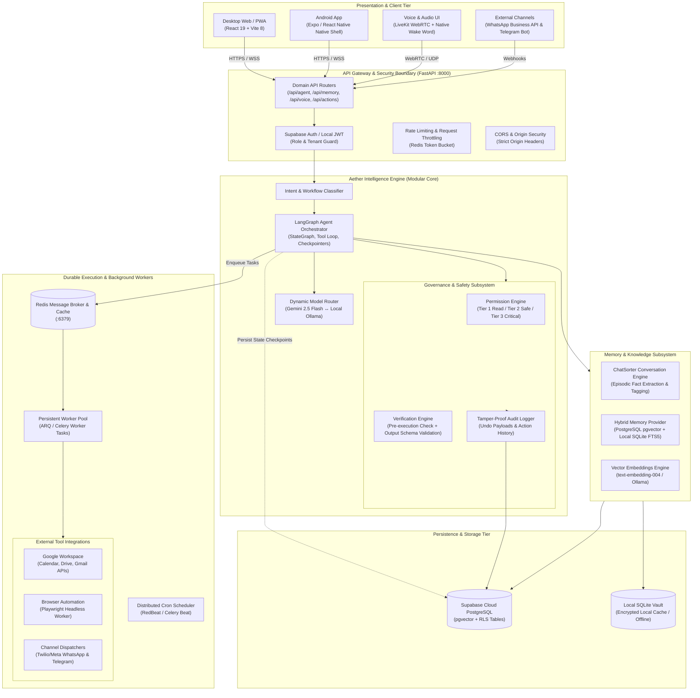
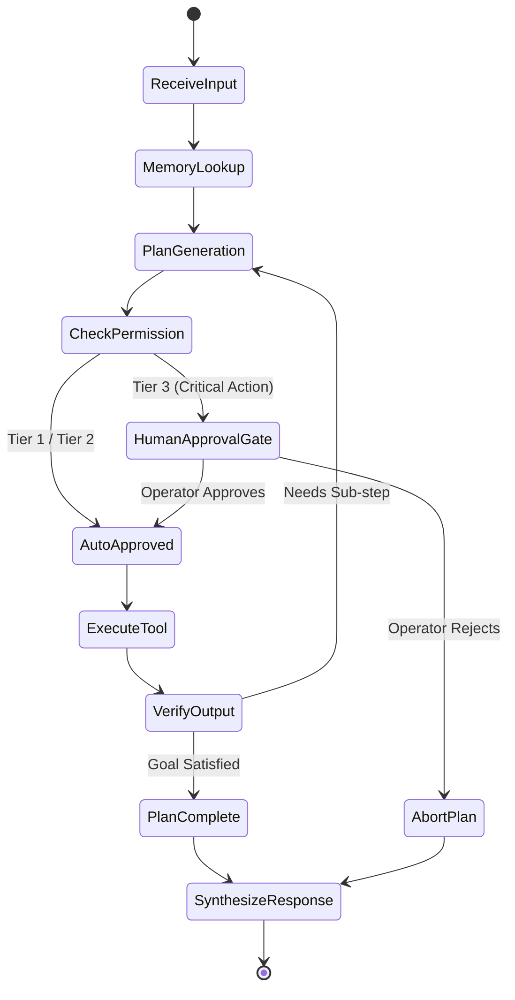
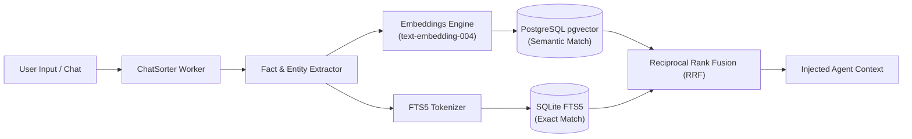

# Aether System Architecture — Target Specification (To-Be)

**Document Version:** 1.0.0  
**Status:** Approved Target Specification  
**Architecture Pattern:** Modular Monolith with Hybrid Cloud/Local Execution  
**Target Horizon:** 12 Weeks (Q4 2026 - Q1 2027)

---

## 1. Architectural Vision & Core Principles

Aether evolves from a reactive, single-turn assistant into a **secure, hybrid-autonomous AI Chief of Staff**. To preserve operational simplicity and avoid the distributed failure modes of microservices, Aether adheres to the following core tenets:

1. **Modular Monolith First:** Keep the entire backend within a well-structured FastAPI codebase with strict domain boundaries (`agent`, `memory`, `execution`, `voice`, `security`). No microservices or Kubernetes overhead.
2. **Local-First, Cloud-Empowered:** Operate local SQLite and Ollama for zero-latency, offline-capable routines; route to Gemini 2.5 and Supabase PostgreSQL for high-order reasoning and cloud persistence.
3. **Deterministic Governance:** Every LLM action must pass through a strict **Permission Engine** and **Verification Engine** before execution. Critical actions (financial transactions, external messages, data deletion) require explicit operator confirmation.
4. **Resilient Background Execution:** Decouple scheduled jobs and long-running workflows from the web server process via a persistent Redis worker queue.
5. **Human-in-the-Loop Agency:** Autonomous workflows pause at critical decision gates, allowing the operator (Pawan Dixit) to inspect, approve, or adjust plans before execution.

---

## 2. Target Architecture Diagram (C4 Level 2 Container)

---

## 3. Core Engine Specifications

### 3.1 LangGraph Autonomous Agent Orchestrator
* **Architecture:** StateGraph with persistent checkpoints stored in PostgreSQL.
* **Execution Cycle:**
  1. `Input Assessment`: Extract user goal, constraints, and implicit parameters.
  2. `Memory Recall`: Query `pgvector` and SQLite FTS5 for relevant past decisions, preferences, and context.
  3. `Plan Generation`: Formulate an executable DAG (Directed Acyclic Graph) of sub-actions.
  4. `Governance Check`: Pass each sub-action to the **Permission Engine**.
  5. `Tool Invocation`: Execute approved tools (Calendar, Finance, Search, Notes, Notification).
  6. `Verification`: Validate tool output schema and business logic before progressing.
  7. `Response Synthesis`: Synthesize multi-modal summary (markdown + native voice).
* **Human-in-the-Loop Gates:** If a tool requires Tier 3 privileges (e.g., executing financial transfer, bulk deletion, public posting), the graph halts at an `interrupt_before` checkpoint and delivers an interactive approval card to the user's screen.

### 3.2 Dynamic Model Router
* **Primary Cloud Model:** Google Gemini 2.5 Flash (high speed, 1M context window, exceptional multilingual Hindi/Hinglish reasoning).
* **Local Offline Model:** Ollama `llama3.2:3b` / `qwen2.5:7b` running locally for simple classification, task parsing, and offline resilience.
* **Routing Heuristics:**
  * Network Disconnected → Route 100% to Ollama.
  * Low Complexity (e.g., "Add task to buy milk", "What time is it?") → Route to Local Ollama to save latency and token costs.
  * High Complexity (Multi-step research, financial ledger analysis, document synthesis, coding) → Route to Gemini 2.5 Flash.

### 3.3 Hybrid Memory Intelligence Subsystem
* **Short-Term Context:** Current session conversation buffer (token-optimized, sliding window).
* **Episodic Memory (ChatSorter):** Background extraction worker that parses raw chats into structured semantic facts:
  * Entities (People, Places, Accounts, Projects).
  * Direct Preferences (e.g., "Operator prefers flights after 10 AM", "Operator lives in Jaipur").
  * Temporal Commitments (Deadlines, promises, recurring events).
* **Long-Term Retrieval (Hybrid Search):**
  * **Vector Similarity:** Supabase PostgreSQL with `pgvector` (`cosine` distance over 768-dimensional embeddings).
  * **Lexical / Keyword Match:** Local SQLite Full-Text Search (`FTS5`) with BM25 ranking for exact names, phone numbers, and IDs.
  * **Hybrid Rank Fusion (RRF):** Merges vector similarity with keyword BM25 scores for high-accuracy recall across English and Hindi.

### 3.4 Governance & Safety Subsystem (Permission & Verification)
* **Tier 1 (Read-Only / Safe):** System status, weather, fetching tasks, reading notes, querying balances. Auto-approved without prompting.
* **Tier 2 (Low-Risk Mutating):** Adding a task, saving a note, recording an expense, setting an alarm. Auto-approved with non-blocking toast notification and 10-second undo capability.
* **Tier 3 (High-Risk / Irreversible):** Deleting tasks/notes, executing financial payouts, broadcasting messages to WhatsApp groups, altering system configurations. Strictly requires interactive biometric or 1-tap confirmation card.
* **Verification Engine:**
  * Pre-execution: Asserts input constraints (e.g., expense amount > 0, dates in future, valid recipient formats).
  * Post-execution: Inspects tool status return; if tool fails or mutates partial state, executes rollback rollback payload registered in `audit_logs`.

---

## 4. Execution & Voice Subsystem

### 4.1 Redis Job Queue & Persistent Background Workers
* Replaces the fragile in-memory `asyncio.sleep(300)` loop.
* **Broker:** Redis 7 running locally or via managed cloud (Upstash / Redis Cloud).
* **Job Queue Engine:** ARQ (Async Redis Queue) or Celery.
* **Capabilities:**
  * Guaranteed delivery of reminders and scheduled digests even if FastAPI restarts.
  * Dead-letter queue (DLQ) for failed notification deliveries.
  * Rate-limited external dispatchers (WhatsApp WABA API rate throttling).

### 4.2 Real-Time Voice Streaming Gateway (LiveKit)
* Replaces high-latency REST chunked audio synthesis.
* **Protocol:** WebRTC sub-200ms bi-directional audio stream.
* **Voice Activity Detection (VAD):** Silero VAD running at edge to detect speech initiation and termination instantly.
* **Speech-to-Text (STT):** Deepgram / Whisper streaming API.
* **Text-to-Speech (TTS):** Streaming voice synthesis with explicit language tag routing (`hi-IN` for Hindi / Hinglish; `en-US` for English) to eliminate synthetic pronunciation artifacts.

---

## 5. Technology Stack Summary

| Layer | Component | Chosen Technology | Architectural Role |
| :--- | :--- | :--- | :--- |
| **Frontend** | Desktop Web & PWA | React 19 + Vite 8 + TailwindCSS | Executive UI, responsive dashboard, real-time widgets |
| **Mobile** | Native Android Shell | Expo 52 / React Native + Native Bridge | Mobile hardware access, background audio, native wake word |
| **API Backend** | Web Framework | Python 3.12 + FastAPI + Uvicorn | High-performance async REST & WebSocket gateway |
| **Orchestration** | Agent Framework | LangGraph + LangChain Core | Cyclical multi-step agent reasoning, tool loop, checkpoints |
| **Database** | Relational & Vector | PostgreSQL 16 (Supabase) + `pgvector` | Primary ACID relational storage + semantic memory search |
| **Local Cache** | Local & Offline Storage | SQLite 3 + FTS5 + SQLCipher | Offline task/finance vault, fast lexical indexing |
| **Migrations** | Schema Versioning | Alembic | Version-controlled, deterministic database migrations |
| **Queue & Cache** | Message Broker | Redis 7 + ARQ | Persistent background jobs, schedule queue, rate limiting |
| **Cloud AI** | Multimodal LLM | Google Gemini 2.5 Flash | High-speed, complex reasoning, 1M context, multilingual |
| **Local AI** | Offline LLM | Ollama (`llama3.2` / `qwen2.5`) | Private, zero-latency local fallback execution |
| **Voice Streaming**| WebRTC Engine | LiveKit Server + Client SDK | Sub-200ms bidirectional real-time audio pipeline |
| **Observability** | Distributed Tracing | OpenTelemetry (OTel) + Sentry | End-to-end request tracing, error triage, latency tracking |
| **Deployment** | Containerization | Docker + Docker Compose | Hermetic multi-container local and production deployment |

